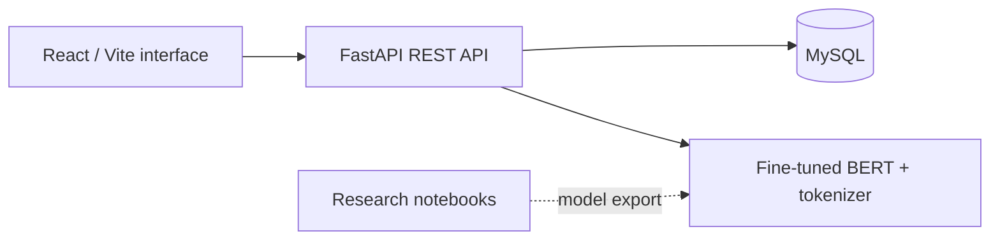

# Intelligent Email Spam Detection

A full-stack academic project combining machine learning research with an email-style web application. A fine-tuned BERT classifier assigns incoming messages a spam probability, while a React interface provides inbox management, message composition, and classification statistics.

The research notebooks explore **logistic regression, GRU, and BERT**. The running API uses **BERT**.

## Features

- Account registration and JWT-based sign-in, with bcrypt password hashing.
- Message composition between registered users, with spam classification of the subject and body.
- Inbox, spam, sent, and trash views; restore and permanent-delete actions.
- Manual spam/ham corrections and profile editing.
- A dashboard with message counts, spam rate, a seven-day distribution, and top senders.
- Notebook experiments covering preprocessing, training, evaluation, and model comparison.

Messages are stored and exchanged **inside this application**. The project does not connect to Gmail/Outlook or send messages over SMTP. Manual corrections are recorded in the database; they do not automatically retrain the classifier.

## Architecture



| Layer | Technologies |
| --- | --- |
| Frontend | React, Vite, React Router, Tailwind CSS, Axios, Recharts, Framer Motion |
| Backend | FastAPI, SQLAlchemy, Pydantic, JWT, Passlib/bcrypt |
| Inference | PyTorch, Hugging Face Transformers, BERT |
| Storage | MySQL, PyMySQL |
| Research | scikit-learn, NLTK, PyTorch; TensorFlow/Keras in the earlier notebook |

## Repository layout

```text
.
├── README.md
├── .gitignore
├── requirements-ml.txt
├── dataset/                          # Dataset acquisition notes; no raw emails
├── spam_detection_pytorch.ipynb      # PyTorch model comparison
└── spam-detector/
    ├── backend/
    │   ├── main.py                  # API routes and BERT inference
    │   ├── auth.py                  # JWT helpers
    │   ├── database.py              # SQLAlchemy models and database connection
    │   ├── schemas.py               # Request schemas
    │   ├── migrate.py               # Legacy one-off migration
    │   ├── requirements.txt
    │   ├── .env.example
    │   └── bert_spam_model/         # Local model bundle; excluded from Git
    ├── data/                        # Local dataset instructions
    ├── ml/spam.ipynb                # Earlier experiments, including TensorFlow
    └── frontend/vite_project_pfa/   # Actual React application and npm lockfile
```

## Run locally

### Prerequisites

- Python 3.10 or later, with a version supported by your chosen PyTorch build.
- Node.js 22.12 or later in the 22.x line, or another version satisfying the bundled Vite lockfile (`^20.19.0 || >=22.12.0`).
- A local MySQL server and an empty `spam_db` database, with a dedicated application user.
- The trained BERT model and matching tokenizer. These are not included in this source-only repository.

### 1. Prepare the inference model

Restore your existing `bert_spam_model` bundle to `spam-detector/backend/bert_spam_model/`, or export the fine-tuned model and its tokenizer into that directory. Follow the [model bundle instructions](spam-detector/backend/bert_spam_model/README.md).

The API expects **0 = ham**, **1 = spam**. It concatenates the subject and body, tokenizes up to 128 tokens, and predicts spam when the class-1 probability is at least 0.5. CPU and CUDA inference are supported by the code.

### 2. Configure MySQL and the backend

Create the empty database and an application account using your MySQL administration tool. Grant that account the required privileges on `spam_db`; the API creates its tables on startup. Use the same hostname/account combination in MySQL and your connection URL.

From the repository root, in PowerShell:

```powershell
cd spam-detector/backend
python -m venv .venv
.\.venv\Scripts\Activate.ps1
python -m pip install -r requirements.txt
Copy-Item .env.example .env
python -c "import secrets; print(secrets.token_hex(32))"
```

Edit `.env`: set `DATABASE_URL` to your local connection string and `SECRET_KEY` to the generated value. URL-encode special characters in the database username/password. Never commit `.env`.

```powershell
python -m uvicorn main:app --reload --host 127.0.0.1 --port 8000
```

API: <http://127.0.0.1:8000> · Interactive documentation: <http://127.0.0.1:8000/docs>

`requirements.txt` is an initial specification inferred from the code, not a validated lockfile. Transformers 5.0.0 matches the version recorded in the archived model configuration. Test dependency resolution in your environment before freezing a lockfile.

Do not run `migrate.py` for a fresh installation: the current schema already includes `deleted`, while that script unconditionally adds the column. It is only for a matching older database after checking its schema.

### 3. Start the frontend

Open a second terminal at the repository root:

```powershell
cd spam-detector/frontend/vite_project_pfa
npm ci
npm run dev
```

Open the address printed by Vite (normally <http://localhost:5173>). Frontend API URLs are currently hardcoded to local port 8000. Start the API there, or update those URLs consistently if you change the backend address.

Register two local accounts to try sending messages between users. The recipient must already be registered.

## Research notebooks

`spam_detection_pytorch.ipynb` compares a TF-IDF/logistic classifier implemented with PyTorch, a GRU, and fine-tuned BERT. `spam-detector/ml/spam.ipynb` contains earlier scikit-learn, TensorFlow/Keras, and Transformers experiments.

Install optional notebook dependencies in a separate research environment:

```powershell
python -m pip install -r requirements-ml.txt
python -m jupyter lab
```

The notebooks retain their original experimental code, including Colab-specific cells and dataset paths. Before running locally, skip Google Drive/Colab cells, set the CSV path to your authorized local dataset, and review notebook installation cells rather than running every cell unchanged. NLTK resources may need to be downloaded as requested by the notebook. A GPU is useful for BERT training but is not required by the API code.

The PyTorch notebook exports model and tokenizer to separate `saved_models/bert_model/` and `saved_models/bert_tokenizer/` directories. For API use, export both objects to the single runtime model directory or combine the corresponding matching files.

No accuracy claims are published here: notebook outputs were cleared before sharing. Report accuracy, precision, recall, F1, the dataset source, split, and evaluation conditions together when publishing reproducible results.

## Data and model files

Raw CSVs, model weights, pickle files, virtual environments, and notebook outputs are not needed in the source repository. Acquisition instructions remain in the relevant directories. Dataset provenance and redistribution licenses were not supplied with the archive, so raw email data is excluded pending verification.

Do not commit personal inbox exports, production database dumps, credentials, or JWT tokens. Keep the npm lockfile: it belongs to the source project and supports consistent frontend installations.

## Current limitations

This is a local academic prototype. Before exposing the API to other users:

- Add authentication and per-message ownership checks to every email read/update/delete route. Several routes currently omit authentication or fetch messages by ID without verifying ownership.
- Restrict CORS to the intended frontend origins and review token handling, rate limits, and input limits.
- Replace the `/email/{id}/keywords` implementation: it currently expects scikit-learn pipeline attributes on the BERT model and is incompatible with the active inference backend.
- Review shared-message deletion semantics: the current `deleted` flag applies to the message record rather than a separate mailbox entry for each user.
- Add automated tests and validate database migrations and dependency versions.

The repository preparation checked source syntax and publishing hygiene; it did not run MySQL, install all application dependencies, train models, or verify the application end to end.

## License

No license was included in the supplied project. Choose a license only after confirming rights to the code and third-party material. Dataset and model terms must be assessed separately.
